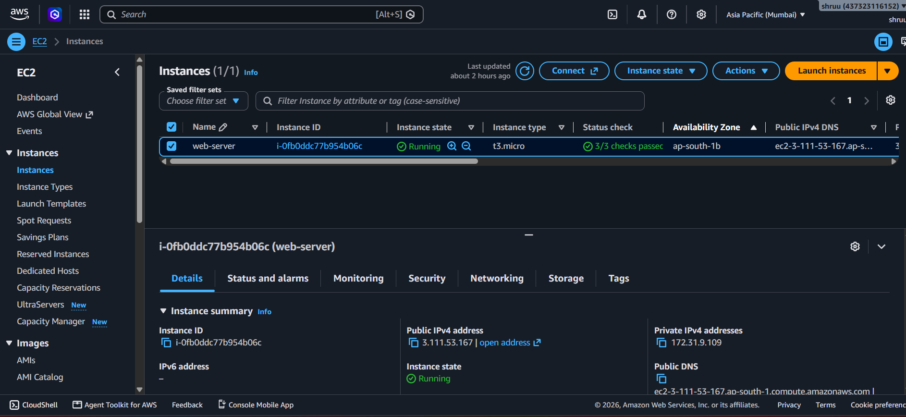
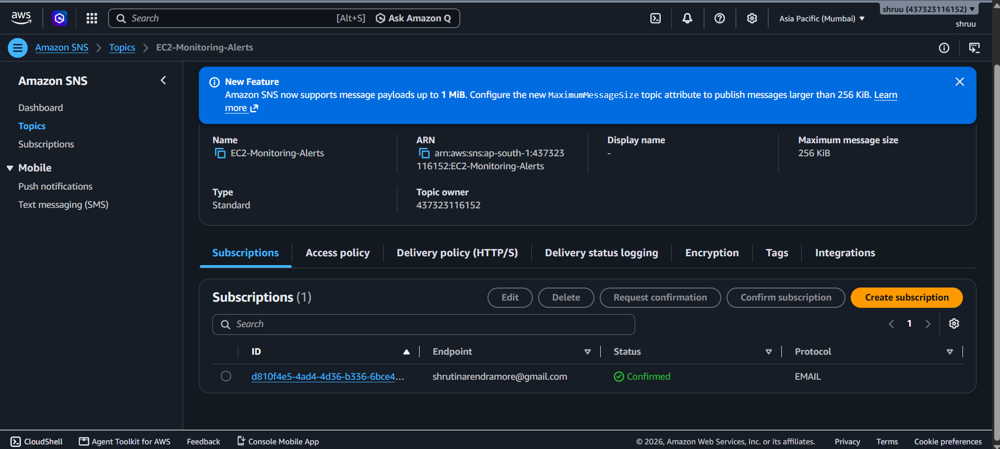
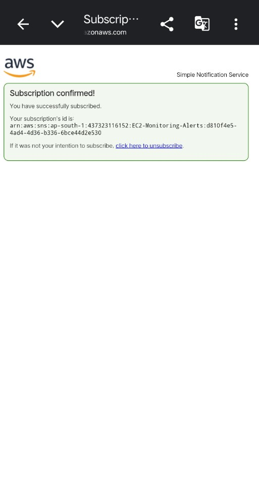
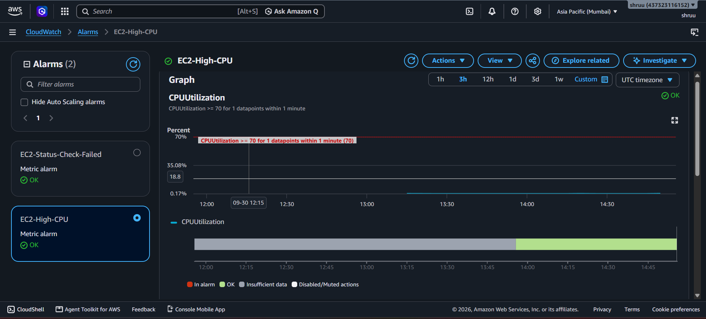
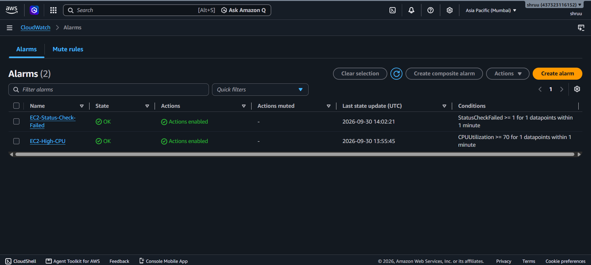
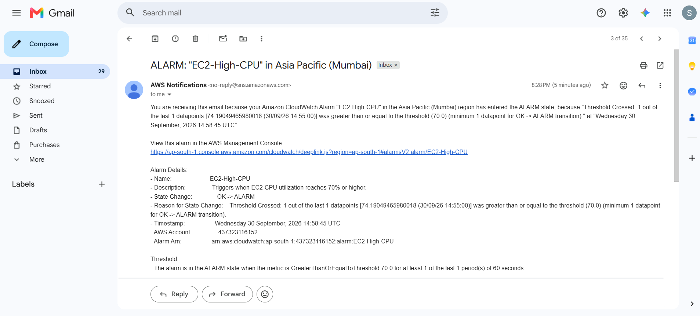

# AWS EC2 Monitoring Solution using CloudWatch and SNS

## Project Overview

This project implements a monitoring and notification solution for an AWS EC2 web server using **Amazon CloudWatch** and **Amazon SNS**.

The EC2 instance runs an Ubuntu web server with Nginx. CloudWatch monitors the instance metrics and generates alarms when predefined thresholds are crossed. Amazon SNS is used to send alarm notifications to an email address.

## AWS Services Used

* Amazon EC2
* Amazon CloudWatch
* Amazon SNS
* Ubuntu
* Nginx

## Architecture

```text
                    Internet
                       |
                       v
              +-----------------+
              |   EC2 Instance  |
              | Ubuntu + Nginx  |
              |   Web Server    |
              +--------+--------+
                       |
                       | EC2 Metrics
                       v
              +-----------------+
              |   CloudWatch    |
              +--------+--------+
                       |
              +--------+--------+
              |                 |
              v                 v
       +-------------+   +----------------+
       | CPU Alarm   |   | Status Check   |
       | >= 70%      |   | Failed >= 1   |
       +------+------+   +-------+--------+
              |                  |
              +--------+---------+
                       |
                       v
                +-------------+
                |     SNS     |
                | EC2-        |
                | Monitoring- |
                | Alerts      |
                +------+------+
                       |
                       v
                    Email
```

## Project Objectives

The main objectives of this project are:

1. Monitor an EC2 web server using CloudWatch.
2. Monitor CPU utilization.
3. Monitor EC2 instance status checks.
4. Create at least two CloudWatch alarms.
5. Connect the alarms to an SNS topic.
6. Receive email notifications when an alarm enters the ALARM state.
7. Test the monitoring solution.
8. Document the notifications generated during testing.

## EC2 Web Server

The monitoring solution was configured for an existing Ubuntu EC2 web server running Nginx.

Example configuration:

```text
Operating System: Ubuntu
Web Server: Nginx
AWS Region: <YOUR-REGION>
Instance ID: <YOUR-INSTANCE-ID>
```

## SNS Configuration

An SNS topic was created with the following name:

```text
EC2-Monitoring-Alerts
```

An email subscription was added to the topic.

The subscription was confirmed through the confirmation email sent by AWS SNS.

## CloudWatch Alarm 1 — High CPU Utilization

The first alarm monitors the CPU utilization of the EC2 instance.

Configuration:

```text
Alarm Name:
EC2-High-CPU

Metric:
CPUUtilization

Statistic:
Average

Period:
1 minute

Threshold:
CPUUtilization >= 70%

Alarm Action:
EC2-Monitoring-Alerts SNS Topic
```

### Purpose

This alarm helps identify situations where the EC2 server is experiencing high CPU utilization.

## CloudWatch Alarm 2 — Instance Status Check

The second alarm monitors the EC2 instance status check metric.

Configuration:

```text
Alarm Name:
EC2-Status-Check-Failed

Metric:
StatusCheckFailed

Statistic:
Maximum

Period:
1 minute

Threshold:
StatusCheckFailed >= 1

Alarm Action:
EC2-Monitoring-Alerts SNS Topic
```

### Purpose

This alarm is designed to notify the administrator when the EC2 instance reports a failed status check.

## CPU Alarm Testing

To test the CPU alarm, CPU load was generated on the Ubuntu EC2 instance.

The following commands were used:

```bash
sudo apt update
sudo apt install stress -y
```

CPU load was then generated using:

```bash
stress --cpu 2 --timeout 300
```

The CPU utilization increased and CloudWatch evaluated the metric.

The CPU alarm changed from:

```text
OK
```

to:

```text
ALARM
```

## SNS Notification Testing

After the CPU alarm entered the ALARM state, SNS sent an email notification.

The notification documented the following state change:

```text
EC2-High-CPU

OK -> ALARM
```

After CPU utilization returned below the configured threshold, the alarm returned to:

```text
ALARM -> OK
```

A recovery notification was also received when configured for the alarm state changes.

## Status Check Alarm

The EC2 status check alarm was configured and connected to the same SNS topic.

Under normal conditions, the instance status check remains healthy and the alarm remains:

```text
OK
```

The alarm configuration was verified from:

```text
CloudWatch
→ Alarms
→ EC2-Status-Check-Failed
```

## Notification Flow

The complete notification flow is:

```text
EC2
 |
 | Metrics
 v
CloudWatch
 |
 | Alarm triggered
 v
SNS Topic
 |
 | Email notification
 v
Administrator
```

## Testing Results

| Test                  | Expected Result                | Result |
| --------------------- | ------------------------------ | ------ |
| EC2 running normally  | CPU alarm remains OK           | Passed |
| Increase CPU usage    | CPU alarm enters ALARM         | Passed |
| CPU returns to normal | CPU alarm returns to OK        | Passed |
| SNS subscription      | Subscription confirmed         | Passed |
| Status check alarm    | Alarm configured and monitored | Passed |
| Email notification    | SNS sends notification         | Passed |

## Screenshots

The following screenshots were captured during the implementation:

### Screenshot 1 — EC2 Instance



### Screenshot 2 — SNS Topic



### Screenshot 3 — SNS Email Subscription



### Screenshot 4 — CloudWatch Status Check Alarm



### Screenshot 5 — CPU Alarm in ALARM State



### Screenshot 6 — SNS Notification



## Key Learnings

Through this project, I learned how to:

* Monitor EC2 instances using Amazon CloudWatch.
* Understand EC2 CPU utilization metrics.
* Monitor EC2 instance status checks.
* Create CloudWatch alarms.
* Configure alarm thresholds.
* Connect CloudWatch alarms with SNS.
* Configure email subscriptions in SNS.
* Test CloudWatch alarms using CPU load.
* Verify alarm state changes.
* Document monitoring and notification results.

## Conclusion

This project demonstrates a basic AWS monitoring and alerting solution for an EC2 web server.

CloudWatch collects and evaluates EC2 metrics, while SNS provides email-based notifications when configured alarm conditions are met. This helps an administrator identify abnormal server conditions and respond to them quickly.

## Technologies

```text
AWS EC2
AWS CloudWatch
AWS SNS
Ubuntu
Nginx
Linux
```
## Author 
** Shruti More **
